<div align="center">

# GaitLogic Planner

### A training plan, workout log, pace calculator, and review workspace for runners

GaitLogic Planner turns scattered running data from spreadsheets, watch apps, notes, and chat history into a structured training workspace that can be maintained, reviewed, and improved over time.

**Plan smarter. Run calmer. Review honestly.**

<p>
  <a href="docs/更新历史.md"></a>
  
  
  
  
</p>

<p>
  <a href="README.md">简体中文</a> ·
  <a href="#-at-a-glance">At a Glance</a> ·
  <a href="#-core-features">Features</a> ·
  <a href="#-system-introduction">System Introduction</a> ·
  <a href="#-quick-start">Quick Start</a> ·
  <a href="#-project-boundaries">Boundaries</a>
</p>

</div>

---

## 🧭 At a Glance

GaitLogic Planner is not a simple running check-in app. It is designed around the complete training management loop:

```text
Plan -> Execute -> Log -> Analyze -> Review -> Adjust -> Continue
```

AI-generated content is only a draft for planning. It is not medical advice, rehabilitation guidance, or a professional coaching prescription. Training should still be adjusted according to recovery, injury history, weather, terrain, and real feedback.

| Problem | How GaitLogic Planner Helps |
| --- | --- |
| Training plans live in Excel, execution lives in watch apps, and reviews live in chat notes | Training cycles, blocks, daily workouts, logs, and stats are kept in one system |
| New users are overwhelmed by a complex dashboard | Users land on Today's Workout by default; mobile uses a bottom navigation bar |
| Tables and nested feature pages are awkward on phones | Mobile tables scroll horizontally with readable action buttons; pages opened from My support swipe-right back |
| Raw English status values appear in tables | Common business, sync, and draft statuses are mapped to localized Chinese labels in the UI |
| You want AI help, but do not want AI to overwrite your real plan | AI creates editable drafts only; users must explicitly apply them |
| You want to see the whole month's completion status at a glance | The training calendar shows planned workouts, completion states, today's highlight, and monthly summary |
| Pace zones are hard to maintain by memory | Recent race results estimate VDOT-like ability and generate training pace zones |
| Age and sex should provide context, not override training paces | Age/sex grading is shown as a separate reference analysis and never changes the original VDOT or pace zones |

---

## 🧩 Badge Matrix

| Type | Status |
| --- | --- |
| Frontend |     |
| Backend |    |
| Data |   |
| AI |   |
| Quality |   |

---

## ✨ Core Features

| Daily Use | Planning | Analysis | AI & Admin |
| --- | --- | --- | --- |
| 🏠 Today's Workout | 📋 My Training Plan | 📅 Training Calendar | 🧠 AI Plan Builder |
| ✍️ Workout Logs | 🧱 Training Cycles | 📊 Training Stats | 📤 AI Draft Export |
| 📱 Mobile Bottom Nav | 🧩 Training Blocks | 🧮 Pace Calculator | ⚙️ AI Coach Preferences |
| ↩️ Back to My Page | 📥 Excel Import | 📥 Workout Log Import | 🛠 Admin Console |
| 🔗 Multi-platform Data Sync | 🧾 Sync Job Queue | 🧬 Activity Normalization | 🔐 User Token Encryption |
| 🟢 Single Active Cycle | 🗂 Cycle Lifecycle | 🔁 Transactional Switch | 🧭 Garmin Cycle Assignment |
| 🧾 Beta Feedback | 🏷 Pace Rules | 📈 Completion & Mileage Trends | 🔑 Model Settings |

Training cycles support the `draft`, `active`, `completed`, and `archived` lifecycle. Each user can have at most one `active` cycle. New cycles are drafts by default; activating a new cycle completes the previous active cycle and marks its future unfinished workouts as `superseded` while preserving completed logs, Garmin links, and review history.

Garmin sync is manually triggered and processed by a worker queue. A manual sync request schedules one background run, the page polls job status, refreshes both jobs and activities, and failed or partially successful jobs can be retried. "Auto import after sync" is enabled by default: synced activities are written or merged into `WorkoutLog`, then linked to plans, calendars, and stats. When disabled, Garmin activities are stored only and can be reprocessed manually. Continuous same-day activities can become one composite session, while ambiguous cases go to review.
Local development CORS is configurable through `BACKEND_CORS_ORIGINS` and `BACKEND_CORS_ORIGIN_REGEX`, with defaults for `localhost`, `127.0.0.1`, preview ports, and common LAN debug URLs.

---

## 🚀 Quick Start

### 1. Backend

```bash
python -m pip install -e .
python scripts/init_db.py
uvicorn server.main:app --reload
```

API documentation:

```text
http://127.0.0.1:8000/docs
```

### 2. Frontend

```bash
cd web
npm install
npm run dev
```

### 3. Environment Variables

Example:

```env
MYSQL_HOST=127.0.0.1
MYSQL_PORT=3306
MYSQL_USER=root
MYSQL_PASSWORD=your_password
MYSQL_DATABASE=gaitlogic_planner

JWT_SECRET_KEY=please-change-this-to-a-long-random-secret
ACCESS_TOKEN_EXPIRE_DAYS=7

AI_API_KEY=your_api_key
AI_BASE_URL=https://api.deepseek.com
AI_MODEL=deepseek-v4-flash
AI_TIMEOUT_SECONDS=120

AI_PLAN_DAILY_LIMIT=3
AI_PLAN_COOLDOWN_SECONDS=60
```

Legacy `DEEPSEEK_*` variables are still supported:

```env
DEEPSEEK_API_KEY=your_api_key
DEEPSEEK_BASE_URL=https://api.deepseek.com
DEEPSEEK_MODEL=deepseek-v4-flash
DEEPSEEK_TIMEOUT_SECONDS=120
```

---

## 🧠 Recommended Workflow

### Short Path for New Users

```text
Register and sign in
  ↓
Open Today's Workout
  ↓
Generate a draft with AI or import an Excel plan
  ↓
Fill in workout logs after training
  ↓
Backfill completed workout logs when needed
  ↓
Review progress in Calendar and Stats
```

### Full Training Management Path

```text
Create a training cycle
  ↓
Create training blocks
  ↓
Add daily planned workouts
  ↓
Use Today's Workout / Training Calendar every day
  ↓
Fill in workout logs after training
  ↓
Review training stats
  ↓
Update pace rules with the pace calculator
  ↓
Adjust the plan based on review
```

---

## 🗺 Navigation

<details open>
<summary><strong>Desktop Sidebar</strong></summary>

```text
Common
├── Today's Workout
└── Training Calendar

Plan
├── AI Plan Builder
├── My Training Plan
└── Pace Calculator

More
├── Training Stats
├── Excel Import
├── Workout Log Import
└── Feedback

Advanced Settings (collapsed by default)
├── AI Coach Preferences
├── Training Cycles
├── Training Blocks
└── Pace Rules

Admin Console (admin only)
└── AI Settings
```

</details>

<details open>
<summary><strong>Mobile Bottom Navigation</strong></summary>

```text
Today / Calendar / Plan / Analysis / My
```

The My page aggregates mobile entry points:

- My Training Plan
- Training Stats
- Excel Import
- Workout Log Import
- Feedback
- Advanced Settings

When entering secondary pages from My, a back arrow appears in the content area and returns to My.

</details>

---

## 📦 Feature Overview

| Module | Description |
| --- | --- |
| Account System | Registration, login, JWT auth, and user-level data isolation |
| Today's Workout | Default landing page for checking today's workout and filling logs |
| Training Calendar | Monthly calendar for daily plans, completion status, and monthly summary |
| My Training Plan | Maintain daily planned workouts; mobile uses card lists |
| Workout Logs | Record actual distance, pace, heart rate, RPE, feelings, and review notes |
| Training Stats | Review mileage, completion rate, training type distribution, and trends |
| Excel Import | Download a standard template and import cycles, blocks, and future plans |
| Workout Log Import | Backfill completed workout data through a draft-and-confirm workflow |
| Pace Calculator | Estimate VDOT-like ability and training pace zones from race results |
| Age/Sex Reference | Optional age and sex fields for separate performance reference only |
| Pace Rules | Store REC, E, M, T1, T2, I, R pace rules |
| AI Plan Builder | Generate structured training plan drafts and apply them only after confirmation |
| AI Coach Preferences | Configure training preferences that guide AI draft generation |
| Beta Feedback | Submit bugs, suggestions, UX issues, and training logic feedback |
| Admin Console | Manage users, system entry points, and AI model configuration |

---

## 📘 System Introduction

This section groups product screenshots, workflows and implementation references. Version-by-version changes are recorded in the [changelog](docs/更新历史.md).

### Mobile-first path

<p align="center">
  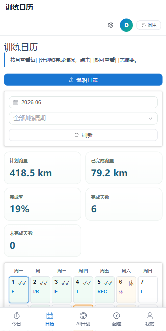
</p>

At widths `<= 768px`, the sidebar is hidden and replaced with a bottom navigation bar:

```text
Today / Calendar / Plan / Analysis / My
```

### Desktop workspace

<p align="center">
  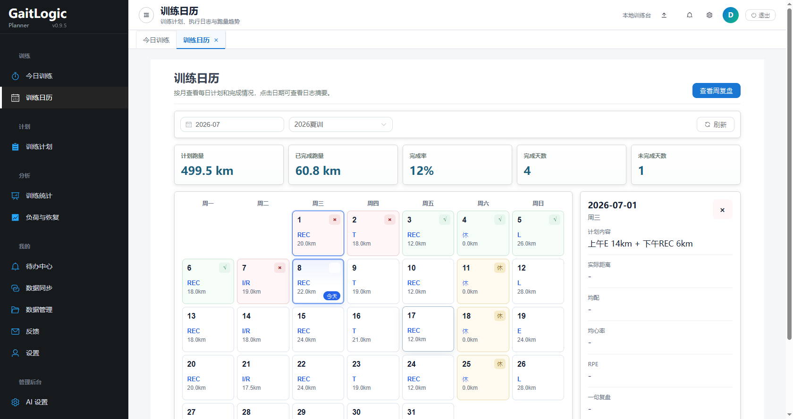
</p>

### 🏗 Architecture

GaitLogic Planner uses a separated frontend and backend architecture:

- Frontend: Vue 3, TypeScript, Vite, Element Plus, ECharts;
- Backend: FastAPI, SQLAlchemy 2.x, MySQL 8.0+;
- Excel: openpyxl;
- AI: OpenAI-compatible SDK;
- Deployment: Nginx reverse proxy for frontend static files and backend API.

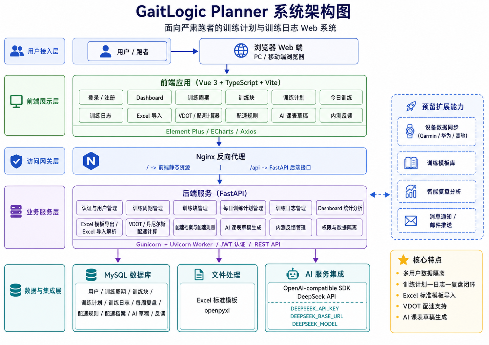

```text
GaitLogic Planner
├── web/                 # Vue 3 + Vite + Element Plus
├── server/              # FastAPI API layer
├── planner_core/        # SQLAlchemy models, config, enums
├── scripts/             # initialization and helper scripts
├── tests/               # pytest tests
├── sql/                 # MySQL schema
└── docs/                # docs, screenshots, changelog
```

### Coach Agent

The read-only Coach Agent uses typed training tools for facts; Runner State and deterministic rules own the decision boundary; the OpenAI-compatible Gateway provides bounded tool orchestration and explanation; and the Validator plus deterministic Fallback prevent unauthorized output and remain useful when the Provider is unavailable.

```text
training facts -> read-only tools -> deterministic rules -> bounded model explanation -> Validator -> explainable advice
```

For today's recommendation, the server owns the decision, plan status, risk, data quality, warnings, limitations, and canonical Evidence. The model only generates narrative text and selects server-issued Evidence IDs. The system does not automatically modify training plans and is not a medical diagnostic tool.

### Runner State Workflow

Runner State provides current runner state, 7/28-day training metrics, deterministic inference, Evidence and data-quality explanations, plus manual history snapshots, trends, and details. When Garmin sync produces a material training-fact change, an independent transaction can create a non-blocking state snapshot:

```text
Garmin training facts -> Material Change -> Runner State -> automatic snapshot -> history trends -> explainable feedback
```

Runner State does not provide medical diagnosis, use a large language model to calculate state, or automatically generate or modify an official training plan.

### Runner State

Runner State derives an explainable current state from recent training facts, data quality, and rule evidence, while preserving history snapshots and trends.

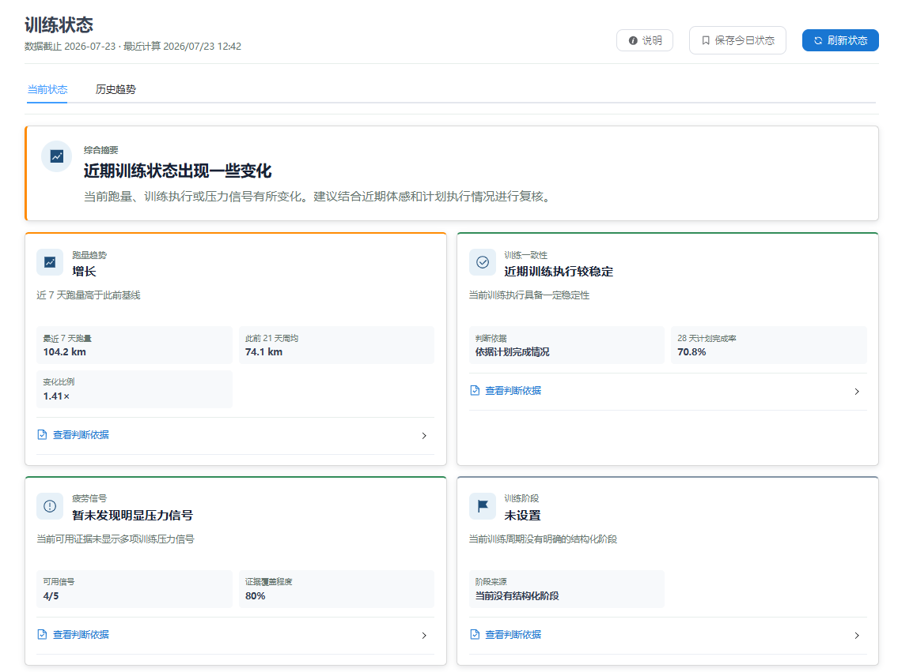

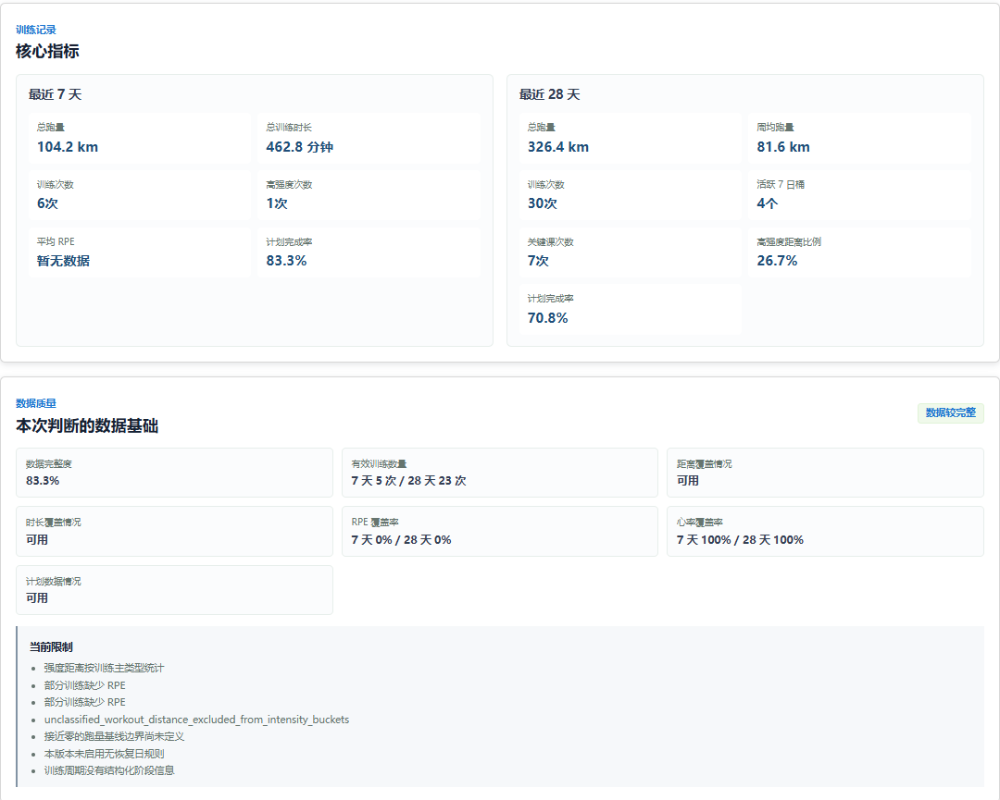

### Training Readiness

Training Readiness presents current training readiness, supporting evidence, and limitations. It is not a medical diagnosis.

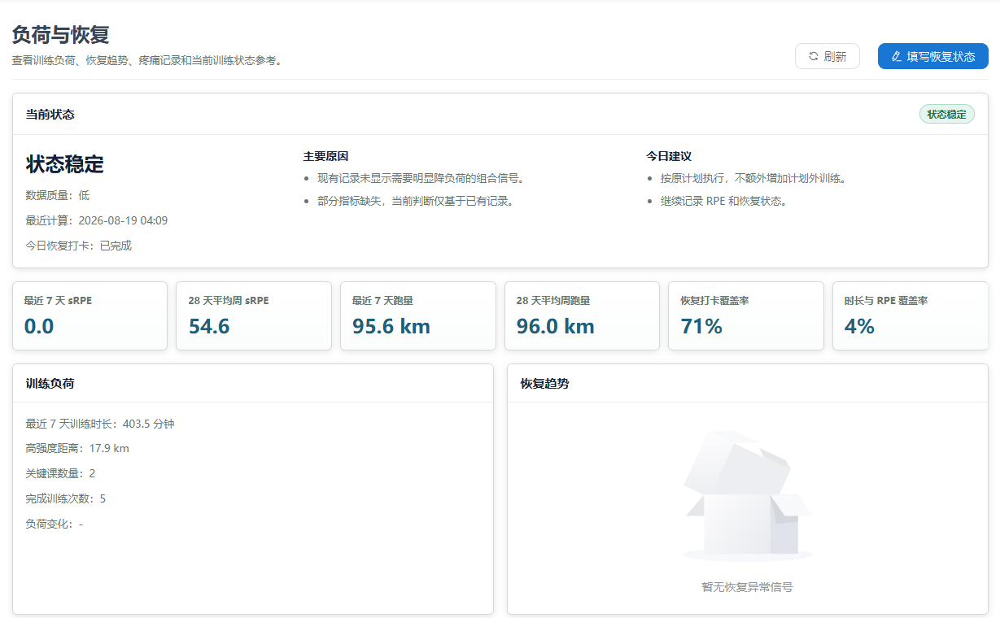

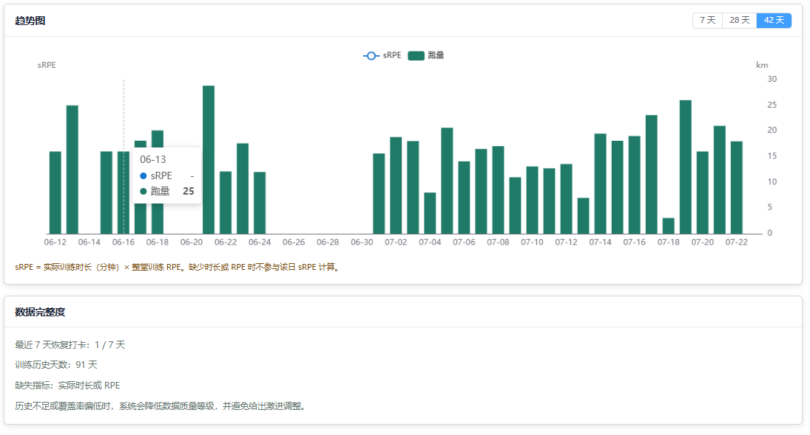

### Coach Architecture

Coach Agent combines structured training facts, deterministic rules, and bounded model explanations in a read-only coaching interface:

```text
structured training data owns facts
-> Runner State and rules own decision boundaries
-> the LLM performs bounded tool orchestration and explanation
-> the Validator blocks unauthorized or rule-overriding output
-> deterministic Fallback remains useful when the Provider is unavailable
```

This is not a generic chat endpoint. The LLM never accesses the database directly, authenticated identity is injected by the server, Tool input and output use strict Pydantic schemas, deterministic rules own the daily Decision, and the model cannot modify an official plan.

### AI Coach Agent

GaitLogic Coach Agent combines structured training facts, deterministic rules, and LLM-based explanation. Runner State and the rule engine define the decision boundary, while the model handles tool orchestration and language generation.


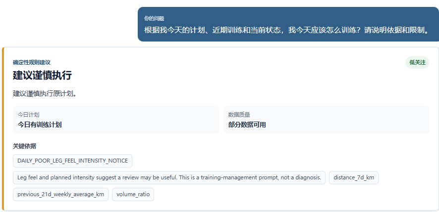

### Agent Observability, Evaluation, and Reliability

The observability layer productionizes the existing Coach, RAG, Weekly Review, and human-approval paths with safe Trace/Span instrumentation, optional OpenTelemetry export, low-cardinality runtime metrics, a unified Provider Failure Taxonomy, bounded retry with deterministic fallback, and four public fictional regression suites. Runtime observability never stores user queries, prompts, training content, raw model output, identity data, or credentials.

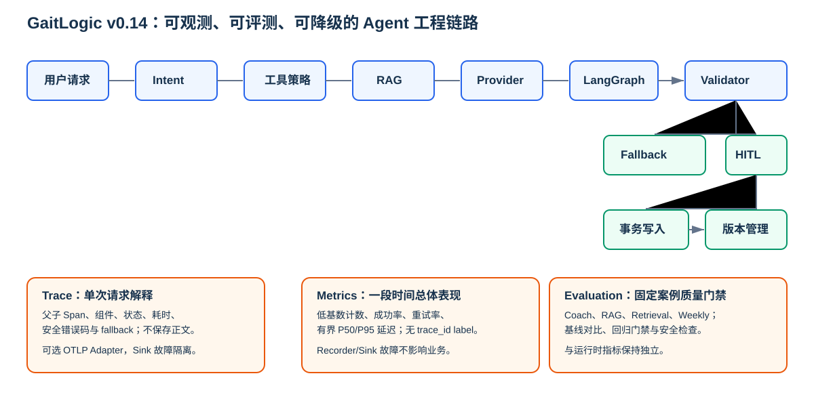

Reproduce the evaluation with `python scripts/evaluate_agent.py --suite all`. Coach, RAG, and Weekly Adaptive pass; Retrieval retains its baseline 17 failures, so the honest overall result is `PARTIAL`, not PASS. See the [v0.14.0 learning map](docs/learning/v0.14.0/00-v0.14.0-overview.md).

### Weekly Review and Adaptive Coaching Loop

The weekly review workflow adds deterministic Weekly Facts, a LangGraph weekly-review workflow, training-knowledge references, inspectable plan-adjustment Proposals, human approval/rejection, persistent checkpoints, plan versioning, and controlled rollback. The model explains and proposes within bounded rules; the server owns facts and validation, and only an authenticated human approval can authorize a transactional plan update.

```text
Training Plan -> Workout Logs -> Weekly Facts -> Rules -> LangGraph Review
              -> Proposal Diff -> Human Approval -> New Plan Version -> Audit/Rollback
```

The UI is available at `/adaptive-weekly-review`. See the [public fictional evaluation](docs/weekly-review/evaluation/weekly-adaptive-eval-v1.md) and the [v0.13.0 learning map](docs/learning/v0.13.0/01-v0.13.0-architecture.md). This capability is not medical advice and does not grant a general database write tool to the LLM.

### Training Knowledge RAG and Trusted References

Coach Agent retrieves versioned training knowledge through the read-only `retrieve_training_knowledge` tool. The model selects only request-scoped Reference IDs; the server validates and materializes the title, source, version, evidence level, and excerpt. Knowledge explains a result but never participates in or overrides the deterministic TODAY Decision.

```text
structured business tools -> runner facts
deterministic rule engine -> decision boundary
Training Knowledge RAG -> professional knowledge and explanations
LLM -> bounded tool orchestration and language
Canonical Reference -> server-materialized trusted sources
Validator / Fallback -> policy enforcement and safe degradation
```


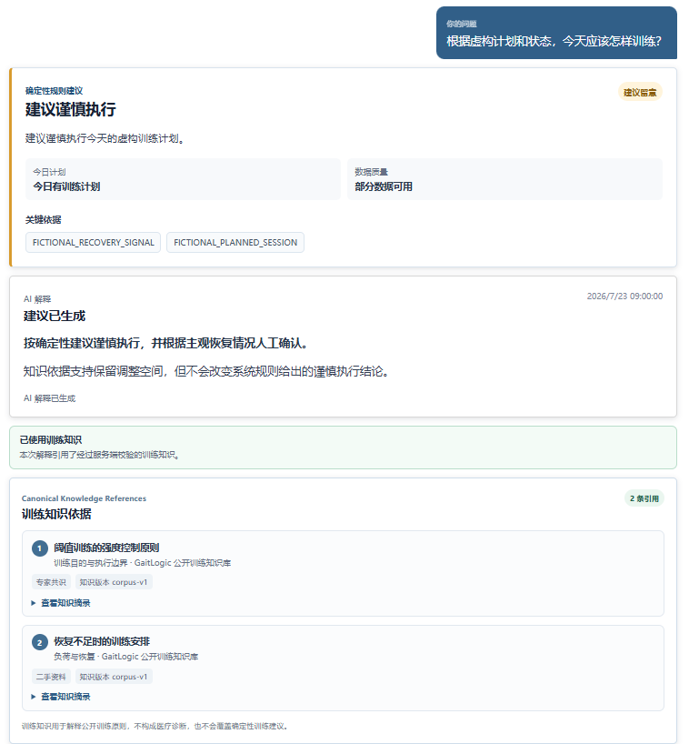

UI and citation details are documented in [Training Knowledge Reference UI](docs/rag/training-knowledge-reference-ui-v1.md); release-specific status belongs in the [changelog](docs/更新历史.md).

### Agent Capabilities

Core training-fact and training-knowledge tools include:

- `get_runner_state`
- `get_runner_state_history`
- `get_recent_training`
- `get_today_workout`
- `get_current_training_cycle`
- `get_training_rules`
- `evaluate_today_workout`
- `get_training_data_quality`
- `retrieve_training_knowledge`

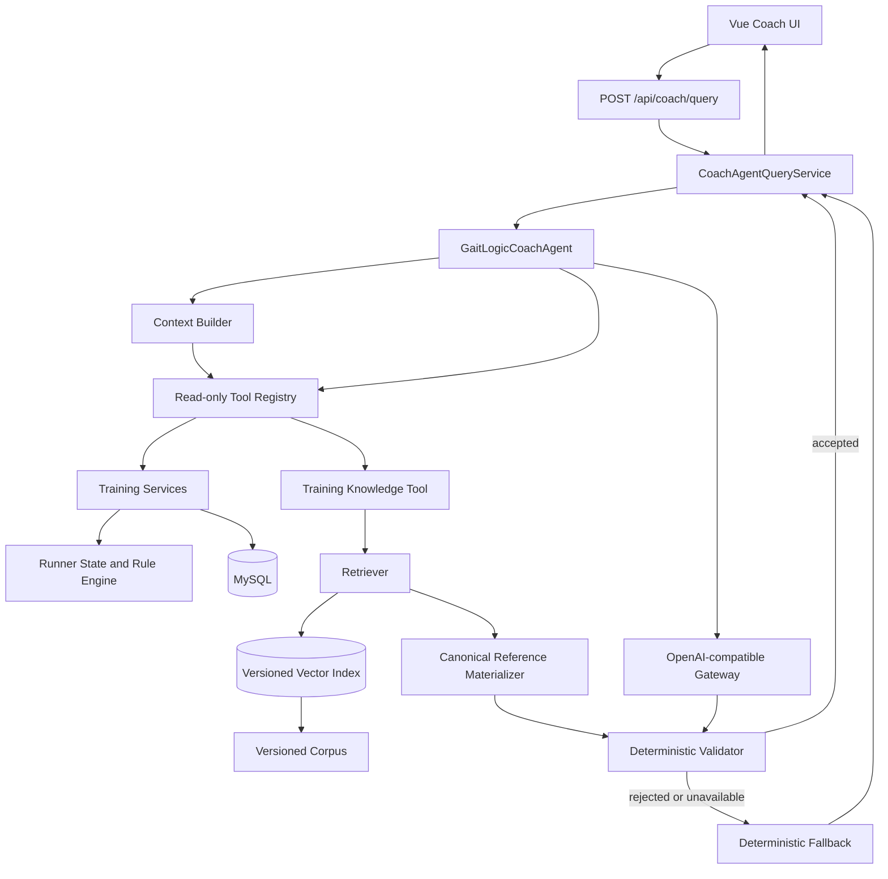

See [Coach Agent Architecture v1](docs/agent/coach-agent-architecture-v1.md) for the complete boundary description.

### Evaluation

Coach Agent Evaluation v1 uses 32 fixed-date, fully fictional cases to check tool recall, Decision and plan consistency, Warning and Limitation retention, Fallback behavior, and unsupported claims. It uses an offline Mock Gateway, reads no API key, accesses no network or production database, and does not use a second LLM as a judge.

See the real run at [Coach Agent Evaluation v1 Results](docs/agent/evaluation/results/coach-agent-eval-v1.md). Reproduce it with:

```powershell
python scripts/evaluate_coach_agent.py
```

### Coach Quick Start

```powershell
# Backend
python -m uvicorn server.main:app --reload

# Frontend
cd web
npm ci
npm run dev
```

The Coach Provider is disabled and its API key is empty in `.env.example`. In that mode `/coach` demonstrates the deterministic read-only Fallback. See [Coach Agent Demo v1](docs/agent/coach-agent-demo-v1.md).

Before deploying Training Knowledge RAG, run the offline deployment checks:

```powershell
python scripts/knowledge_corpus.py validate
python scripts/knowledge_index.py validate --index-id <configured-index-id>
python scripts/check_coach_rag_readiness.py --require-enabled
python scripts/smoke_coach_rag.py
```

Readiness performs no network request and prints no credential. Smoke uses immutable fictional read-only fixtures and does not retain raw Provider answers. See [v0.12.0 Alpha Onboarding](docs/alpha/gaitlogic-v0120-alpha-onboarding.md) and the [Incident Runbook](docs/alpha/gaitlogic-v0120-alpha-incident-runbook.md).

Retrieval supports Dense Exact, optional Qdrant, BM25, Hybrid RRF and an optional reranker; the active strategy depends on deployment configuration. Public tools are read-only. Formal plan changes require approval and server-side validation. Long-term memory across conversations, streaming and a multi-agent runtime are not implied by these capabilities.

### MCP Read-only Interoperability

GaitLogic exposes authenticated, read-only training facts and public knowledge over MCP. Six tools cover current plans, recent training, runner state, training knowledge, selected-activity details and separately authorized recovery trends. Clients cannot supply a user_id to select another runner. Activity selection, source limitations and permission checks remain server-owned.

See the [MCP integration report](docs/evaluation/mcp-remote-e2e-report.md) for tested versions and deployment status.

### Training Management Pages

<details>
<summary><strong>Login and Registration</strong></summary>

Users need an account before using the system. Each user has an isolated data space for training cycles, workouts, logs, pace rules, and AI drafts.

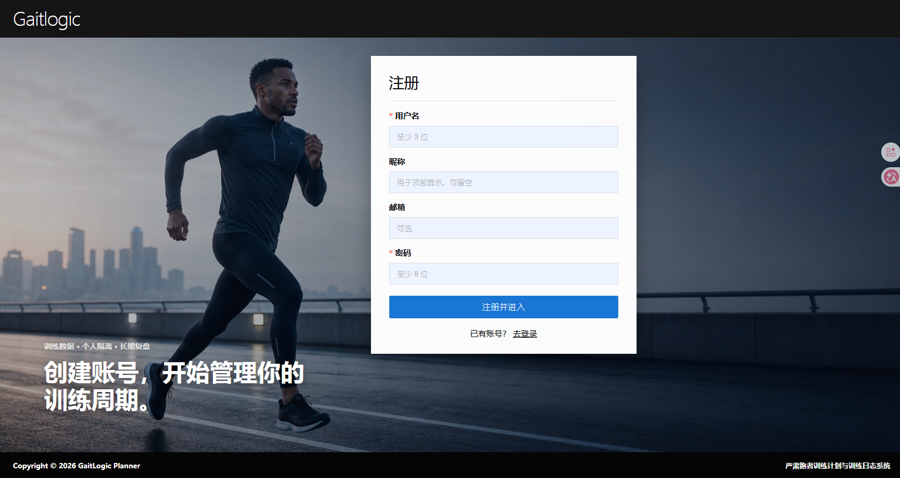

After login, the frontend stores authentication state and automatically sends the token with subsequent requests. The backend binds data to the current user; the frontend does not pass `user_id` manually.

</details>

<details>
<summary><strong>Today's Workout</strong></summary>

Today's Workout is the default home page for ordinary users.

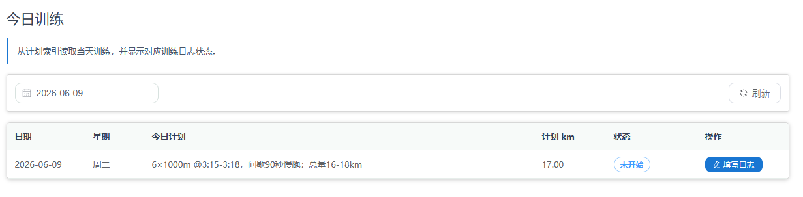

It helps runners check:

- whether there is training today;
- planned type and distance;
- how the workout should be executed;
- current log completion status;
- the log entry after training.

If a new user has no training cycle yet, the page shows onboarding actions for AI plan generation and Excel import.

</details>

<details>
<summary><strong>Training Calendar</strong></summary>

The Training Calendar displays daily plans and completion states in a monthly calendar.

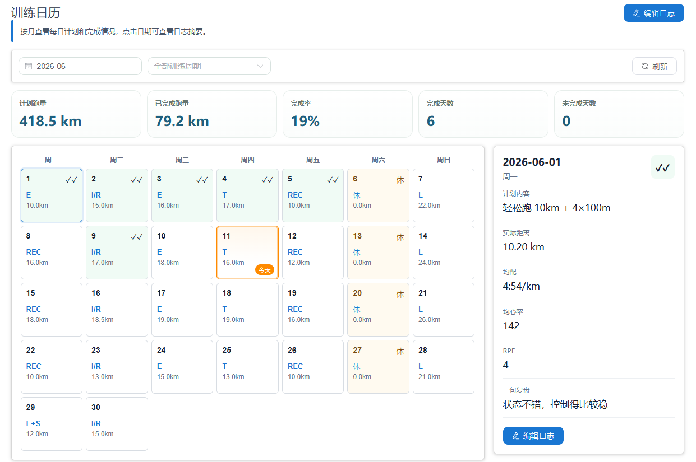

Each day can show:

- date;
- main training type;
- planned distance;
- completion marker;
- today's highlight.

Status markers:

| Status | Marker |
| --- | --- |
| completed_high | `✓✓` |
| completed_normal | `✓` |
| completed_adjusted | `△` |
| missed | `×` |
| rest | `rest` |
| not_started | blank |

The page also displays monthly planned mileage, completed mileage, completion rate, completed days, and missed days.

Clicking a day opens details such as planned content, actual distance, average pace, average heart rate, RPE, review note, and a link to edit the log.

</details>

<details>
<summary><strong>My Training Plan and Workout Logs</strong></summary>

My Training Plan maintains daily planned workouts.

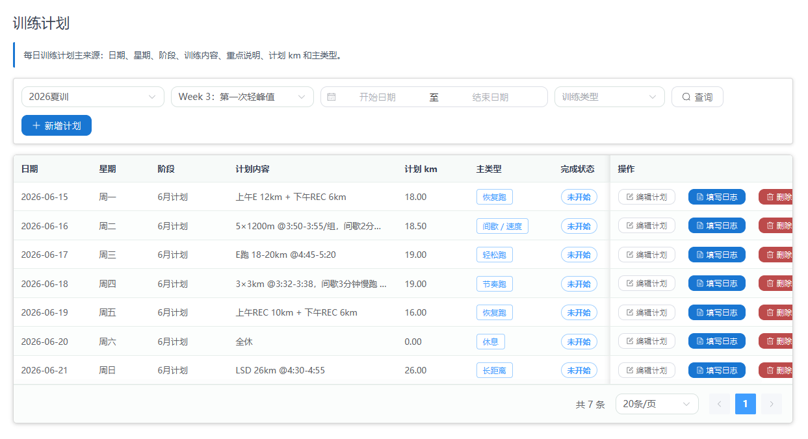

A planned workout usually includes:

- date;
- training cycle;
- training block;
- workout type;
- planned distance;
- planned content;
- focus note.

On mobile, wide tables are replaced by card lists for easier reading and actions.

After training, users can fill in workout logs to compare actual execution against the original plan.

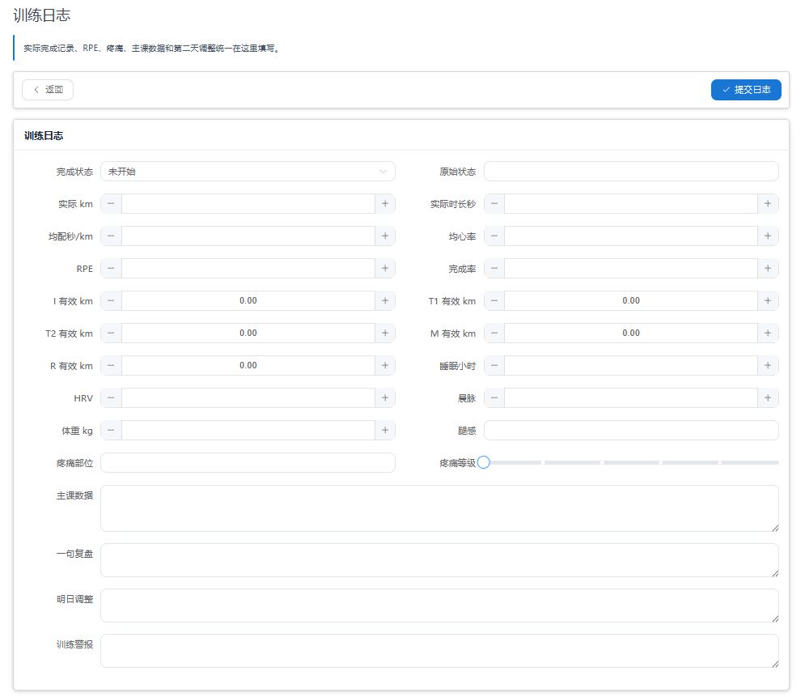

Basic fields are shown by default:

- completion status;
- actual distance;
- actual duration;
- average pace;
- average heart rate;
- RPE;
- main session data;
- short review note.

Advanced fields are collapsible:

- effective kilometers;
- sleep, HRV, morning heart rate, body weight;
- leg feeling and pain;
- adjustment for tomorrow;
- training alert.

</details>

<details>
<summary><strong>Training Stats</strong></summary>

Training Stats gives an overview of recent training data.

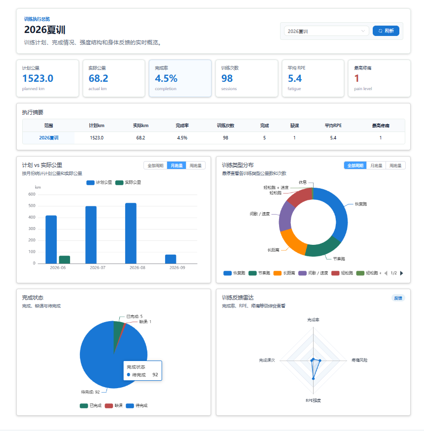

It focuses on:

- recent mileage;
- plan completion rate;
- training type distribution;
- cycle mileage trend;
- missed or accumulated training risk.

</details>

<details>
<summary><strong>Training Cycles and Blocks</strong></summary>

A training cycle is the top-level training structure, useful for a full preparation phase such as summer training, a school race block, a half marathon cycle, or a marathon cycle.

Training blocks divide a cycle into phases:

```text
2026 Summer Training
├── Aerobic Base
├── Threshold Development
├── Race-specific Block
└── Taper / Adjustment
```

These features are placed under Advanced Settings so they do not distract regular users from daily workflows.

</details>

<details>
<summary><strong>Standard Excel Import</strong></summary>

The system supports importing training data through a standard Excel template.

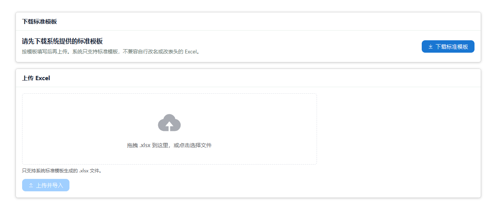

Suitable for users who:

- already have a complete training plan in Excel;
- want to import cycles, blocks, daily plans, and logs in bulk;
- want to migrate from offline spreadsheets into the system.

Only the system-generated standard template is supported. Arbitrary non-standard Excel files are not supported. Do not change sheet names, headers, or field order.

</details>

<details>
<summary><strong>Workout Log Import</strong></summary>

Workout Log Import is for backfilling completed training data. It is separate from Plan Import, which is for future workouts.

Supported inputs:

- pasted structured JSON;
- JSON files;
- Excel `.xlsx`;
- CSV;
- structured TXT or Markdown.

Every import first creates a draft. Users can review parsed counts, matched plans, existing logs, unplanned activities, conflicts, invalid rows, and field-level diffs before applying. Existing manual subjective data such as RPE, pain, notes, feelings, and review text is not silently overwritten.

Template path:

```text
templates/workout-import-template.xlsx
```

API and docs:

- [Workout Import API (source)](server/api/routes/workout_imports.py)
- [Workout Records and Import](#-system-introduction)
- [Workout Import Implementation (source)](server/services/workout_import_service.py)
- [Database Schema (SQL)](sql/schema.sql)

</details>

<details>
<summary><strong>Pace Calculator, Age Reference, and Pace Rules</strong></summary>

The built-in VDOT / Daniels-style pace calculator estimates training pace zones from race results.

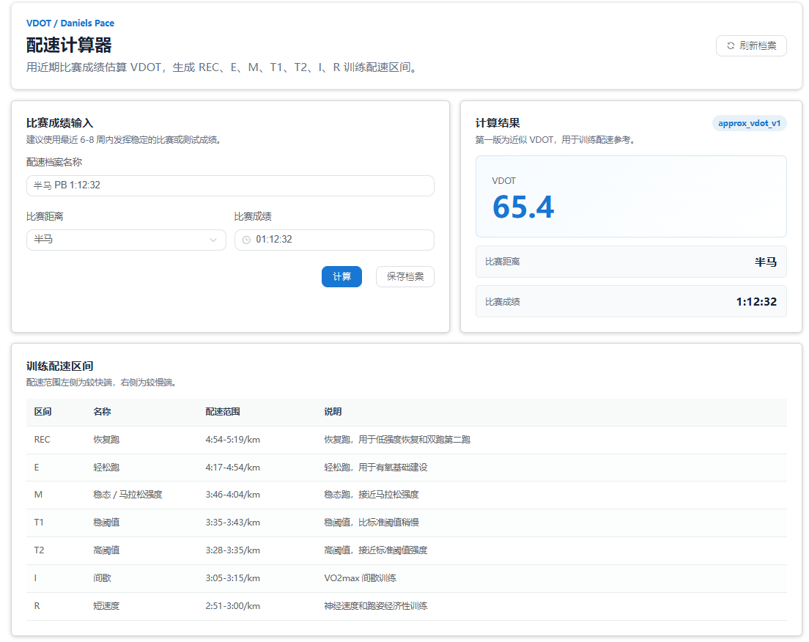

It estimates:

- approximate VDOT;
- REC recovery pace;
- E easy pace;
- M marathon pace;
- T1 / T2 threshold pace;
- I interval pace;
- R repetition pace.

Pace suggestions are training references, not strict execution requirements. Fatigue, weather, terrain, altitude, and current body condition can all affect real pace.

Age / sex reference analysis supports:

- age;
- sex: `male` / `female` / `unknown`.

Training pace zones still come from actual race performance. Age and sex are only used for separate performance reference and do not replace current training ability or override the original VDOT.

The Age Reference Analysis displays age-grade percentage, open-equivalent result, age factor, and a level label as separate reference information.

Pace Rules store the current user's pace system.

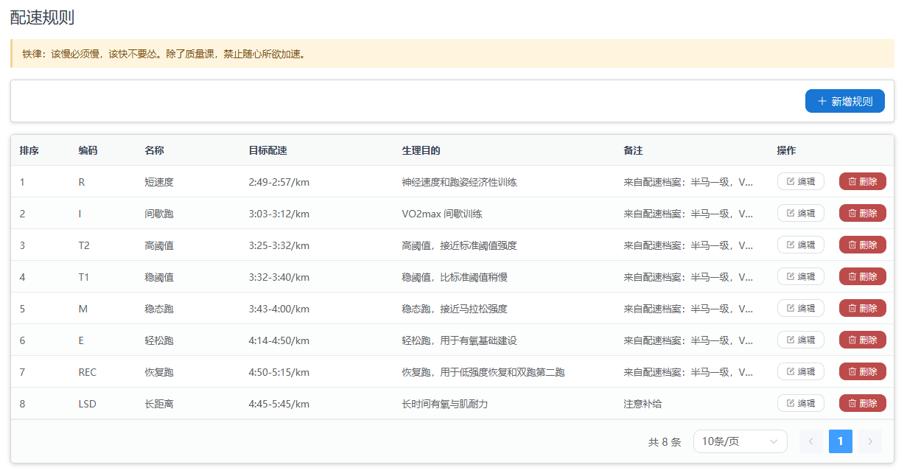

Example:

| Code | Meaning | Example |
| --- | --- | --- |
| REC | Recovery | 5:10-5:50/km |
| E | Easy | 4:35-5:05/km |
| M | Marathon pace | 3:55-4:05/km |
| T1 | Low threshold | 3:38-3:45/km |
| T2 | High threshold | 3:30-3:36/km |
| I | Interval | 3:12-3:20/km |
| R | Repetition | 68-75s/400m |

A pace calculation can be saved as a pace profile and applied to the user's pace rules.

</details>

<details>
<summary><strong>AI Plan Builder, Draft Export, and Coach Preferences</strong></summary>

The AI Plan Builder generates structured training plan drafts from runner information.

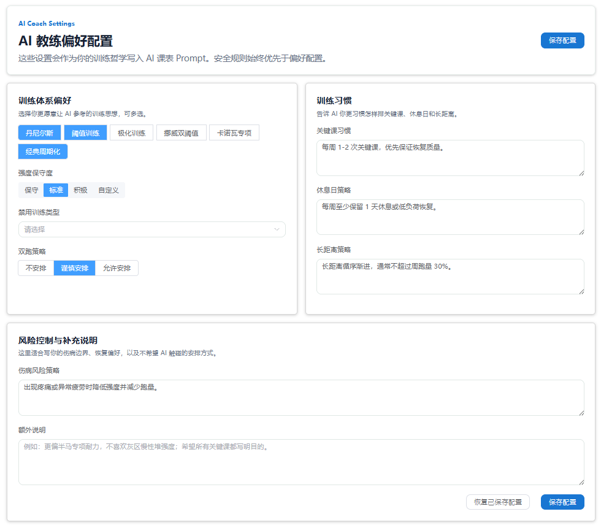

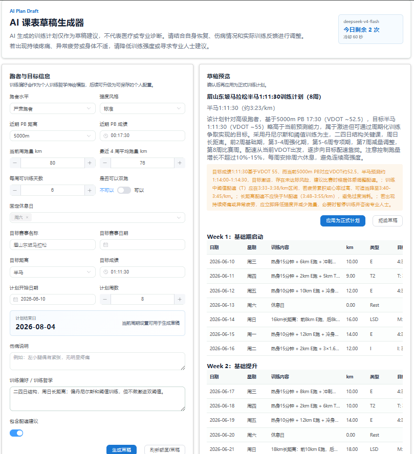

Typical inputs include:

- current mileage;
- recent PB;
- target race;
- target result;
- available training days per week;
- plan length;
- runner level;
- intensity style;
- training preferences;
- injury or limitation notes.

AI does not overwrite formal plans directly:

```text
Generate AI draft
  ↓
User reviews and confirms
  ↓
Click "Apply as formal plan"
  ↓
Write training cycle, blocks, daily workouts, and default logs
```

Default rules:

- each user can generate up to 3 drafts per day;
- at least 60 seconds between two generations for the same user;
- same input within 24 hours reuses the cached draft;
- drafts, invocation logs, and quota are isolated per user.

AI drafts can be exported as:

- Excel workbook;
- CSV table;
- Markdown document;
- JSON data;
- calendar ICS;
- Garmin / COROS reference CSV.

Garmin / COROS reference CSV files are only for manual entry or secondary conversion. They do not connect to device accounts and do not claim to be official local workout import formats.

</details>

<details>
<summary><strong>Admin Console</strong></summary>

The Admin Console is visible only to users with `role = admin`.

Current admin features:

- user management: view users, edit roles, enable or disable accounts;
- system settings: central management entry and system-wide notes;
- AI settings: model service, API key, generation quota, and model parameters.

AI settings support OpenAI-compatible model APIs:

- DeepSeek remains the default preset;
- custom Base URL is supported;
- custom model name is supported;
- temperature, top_p, timeout, max_tokens, and daily quota are configurable.

</details>

<details>
<summary><strong>Beta Feedback</strong></summary>

The feedback module helps beta users submit issues and suggestions.

Supported feedback types:

- page bugs;
- data issues;
- Excel import issues;
- AI generation issues;
- feature suggestions;
- UX problems;
- training logic suggestions.

</details>

---

## 🧰 Tech Stack

| Layer | Tech |
| --- | --- |
| Frontend | Vue 3, TypeScript, Vite, Element Plus, ECharts, Axios |
| Backend | FastAPI, SQLAlchemy 2.x, MySQL 8.0+, PyMySQL, Pydantic 2.x, pydantic-settings |
| Excel | openpyxl |
| AI | OpenAI-compatible SDK |
| Tests | pytest |
| Deployment | Gunicorn, Uvicorn Worker, Nginx |

---

## ✅ Tests

Backend:

```bash
python -m compileall -q planner_core server scripts tests
python -m pytest -q
```

Frontend:

```bash
cd web
npm run build
```

Database tests use MySQL only. If MySQL is not available in the current environment, relevant integration tests are skipped. The project does not switch to SQLite.

---

## 📚 Documentation

| Document | Description |
| --- | --- |
| [Changelog](docs/更新历史.md) | Version history |
| [Deployment](docs/DEPLOYMENT.md) | Deployment and runtime notes |
| [Database Design](md/数据库设计.md) | Database structure notes |
| [Excel Field Mapping](md/Excel字段映射.md) | Excel import field mapping |
| [Workout Records and Import](#-system-introduction) | Backfill completed workout logs |
| [Workout Import API (source)](server/api/routes/workout_imports.py) | Workout log import API |
| [Workout Import Implementation (source)](server/services/workout_import_service.py) | Draft, matching, merge, and apply design |
| [SQL Schema](sql/schema.sql) | MySQL schema |

---

## 🚧 Project Boundaries

The current project scope focuses on training plans, workout logs, and review statistics:

- training plan creation and maintenance;
- daily workout logs;
- training calendar and completion visualization;
- training stats and review;
- pace calculator and pace rules;
- standard Excel template import;
- workout log import for completed training data;
- manual Garmin sync;
- AI training plan drafts;
- basic admin configuration.

Explicitly out of scope:

- no scheduled Garmin / COROS auto-sync;
- no full GPS tracks or per-second location storage;
- no mobile app or mini program;
- no ads system;
- no paid subscription system;
- no social features;
- AI must not directly overwrite formal plans;
- no fake age grading or ability correction.

---

## 🧠 Development Principles

- AI must only generate drafts; formal plans require user confirmation.
- Age grading must not override race-result-based training paces.
- Advanced features should not clutter the default path for ordinary runners.
- Training plans, logs, review stats, and data stability have priority.
- Database design should remain compatible with Excel import, workout log import, web plan creation, workout logs, stats review, and future integrations.

---

## 📝 Changelog

See [更新历史](docs/更新历史.md) for detailed version history.

---

## 🐣 Status

GaitLogic Planner is still under active development and is currently closer to a personal training management and beta testing tool.

If you are a runner, coach, sports tech developer, or simply interested in running software and AI-assisted training plans, feedback and contributions are welcome.
