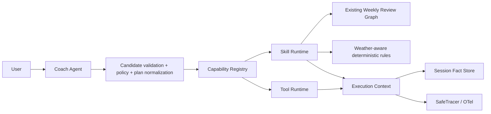

# Agent Capability Runtime

The Agent still uses the existing structured Tool Calling protocol.  The
runtime now classifies a callable capability as either an atomic **Tool** or a
composite **Skill**.  This preserves all existing Tool schemas and validators.

## Boundaries

- A Tool reads one bounded fact. `get_weather` only returns provider facts; it
  does not make a training decision.
- A Skill can compose Tools, Rules, RAG and existing workflows. It never
  applies a training-plan write.
- Any proposed training change remains a draft and continues through the
  existing Proposal → HITL → Approval → Apply workflow.
- A selected Skill suppresses top-level calls to its declared dependencies.
  Runtime execution is still the source of truth because a workflow may take
  conditional branches.

## Request and session facts

`ExecutionContext` caches a successful identical capability invocation only
for one request. Cache hits create `fact.hit`, not a fake `tool.call` span.

`InMemorySessionFactStore` is an optional process-local abstraction for small
safe scalar summaries. It refuses raw outputs, prompts, credentials,
identifiers and coordinates. Garmin sync, log mutations and plan mutations
have explicit invalidation hooks in `agent_fact_invalidation_service`.

## Weather

Weather providers are injected. A disabled or failed provider returns an
explicit unavailable/partial result; it never substitutes current weather for
a forecast. Location input accepts only a coarse label and traces/metrics do
not contain that label, addresses or coordinates. The first deterministic
weather Skill can only create a protected draft indication when configured
thresholds are met.

## Observability

New safe domain spans include `capability.select`, `capability.plan`,
`capability.execute`, `skill.execute`, `fact.lookup` and `fact.invalidate`.
Only stable capability names/statuses are recorded; no request content, raw
Tool output, RAG chunks or location values cross the tracing boundary.
