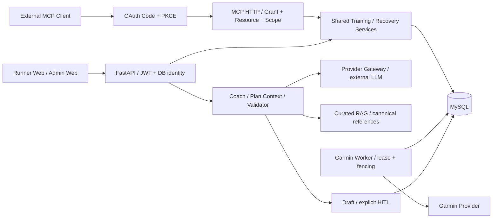

# Security & Performance Audit v1.0 — 安全审计

审计日期：2026-11-13。结论：**尚不具备扩大多用户正式上线的安全验收条件**。本次不是认证、渗透测试或生产安全合格证明。

本文记录审计执行时的快照；“未提交/合并/推送”描述当时的操作边界。后续集成或发布审计材料，不代表下列风险已修复，也不代表候选代码已经部署。

## 1. 基线与执行边界

| 层次 | 本次核对结果 |
|---|---|
| 本地分支 | `codex/mcp-fact-quality-v34` |
| HEAD / master | `ec6f7d6b49d0ff5d6ed66e1f4ad82a2488f12cd8` |
| 本地修改 | 起始快照包含 48 个已修改/未跟踪文件；审计对象包含这些候选修改，不等同于 master 内容 |
| 已有部署记录中的运行代码 | `a82d94f46bb32ba8495095048a2f2a7fb5cef85b`；本轮未连接生产重新核验 |
| 本轮生产操作 | 无 SSH、数据库访问、外网侵入扫描、部署或重启 |
| 本轮代码变更 | 仅新增审计文档、隔离测试与基准脚本；未修复业务代码、未提交/合并/推送 |

原有文件使用 SHA-256 快照保护。详细复现、扫描原始报告、测试进程日志只保存在 Git 忽略的 `.audit-private/`，不应上传公开仓库。测试临时令牌均为虚构账号生成，压测结束删除令牌文件。

## 2. 架构与信任边界

两个前端不是两个权限边界；管理员权限最终依赖后端数据库中的角色。MCP Tool 参数不接受客户端指定身份。部分 MCP 读请求可附带受控同步协调副作用，不能把所有工具简单称为“无任何数据库写入”。隔离压测关闭 Smart Sync，未测自动同步混合负载。

## 3. API 权限矩阵与人工检查

[完整入口矩阵](API_PERMISSION_MATRIX.md)：253 个 API 操作，186 个 USER、52 个 ADMIN、15 个 PUBLIC_OR_HANDLER_AUTH。按展开后的 FastAPI 路由上下文盘点，而不是只遍历顶层延迟 Router；后者会漏报。

| 领域 | 检查证据 | 结论范围 |
|---|---|---|
| 登录/账号停用 | PBKDF2-SHA256、随机盐、恒时比对；每次 `get_current_user` 检查数据库账号状态 | 存在有效控制；跨令牌域问题见 A-01，退出见 A-03 |
| 管理员 | `require_admin_user`、后台 Router 依赖；普通用户访问后台的隔离 HTTP 测试 | 拒绝符合预期；不代表每个字段都已穷举 |
| Cycle / PlannedWorkout | Service 按 user_id 过滤；关联周期/块重新归属检查 | 抽查与跨用户周期读取拒绝通过 |
| WorkoutLog | Update Schema 不含 user_id/cycle_id，Service 先验证计划归属 | 跨周期赋值怀疑被反证；未知字段被忽略，不应误报为已持久化越权 |
| Activity / Recovery | MCP Adapter 服务端身份、独立 recovery scope、详情归属与双用户 TCP 测试 | 定向回归通过，不能覆盖所有历史脏关联 |
| Runner State | 共用事实服务及当前用户，局部指标不等于医疗恢复许可 | 未发现本次已证实的跨用户读取 |
| Conversation / Summary | 会话归属、租约、消息幂等、摘要 CAS；已有合成单元测试 | 定向通过；本轮未穷举所有真实 MySQL 摘要竞争 |
| Plan Draft / Proposal | 草稿 owner 过滤；应用时用户/草稿行锁、规则验证、事务；Proposal 计划 ID 再次 owner 过滤 | 静态控制存在；专项 HITL 集成覆盖另见测试记录 |
| Checkpoint | Saver 以 thread/namespace 存取，业务服务负责 owner 验证 | 不能仅凭 thread UUID 宣称安全；入口/历史版本全链路仍需扩大矩阵测试 |

## 4. 关键发现

完整严重性、代码定位、前提和验证状态见 [风险登记表](RISK_REGISTER.md)。本轮确认的首要问题是令牌信任域隔离和异常日志的数据最小化；Web 退出不撤销令牌也已在隔离 HTTP 中观察到。**不存在本轮已验证的任意用户身份伪造或未登录直接接管账号的证据**。

未修复风险不包含可直接用于公网攻击的请求样例。内部合成复现报告与脚本保存在 `.audit-private/`；公开资料只说明控制缺口和修复验收标准。

## 5. Garmin、MCP 与 OAuth

- Garmin token 使用 AES-256-GCM、随机 nonce、key version 信封；密钥来自配置，缺失/解密失败会拒绝使用。没有读取真实凭据验证生产存储、权限或密钥轮换。
- MCP 自定义验证器检查签名、用途、issuer、resource/audience、有效期、Grant 撤销、用户激活状态；恢复 scope 在取数及同步协调前检查。
- 隔离 MySQL + TCP 回归覆盖双用户、资源绑定、授权码重复兑换、刷新竞争/重放、撤销和训练事实；这些局部成功不能掩盖 Web 入口的 A-01。
- SDK 固定版本存在公告命中，但适用性必须结合自定义验证层。维护方说明自行检查 Audience 可阻断相应风险，不能把 SDK 告警直接算成 GaitLogic 已可利用漏洞。[官方 MCP advisory](https://github.com/modelcontextprotocol/python-sdk/security/advisories/GHSA-w4fh-qvv9-3v23)
- 未触发 Garmin 同步，未访问真实活动、恢复或 GPS；跨用户相同上游 activity ID、异常关联历史记录、生产 worker 最小权限仍待专项核验。

## 6. AI / RAG / 文件处理

- Tool Registry 检查 read_only、allowed_intents、输入与输出 Schema；工具异常仅记录安全名称和异常类型。不能依靠 System Prompt 替代这些权限检查。
- Agent 调用轮数/工具次数/Provider 超时有界；AI Plan 格式修复最多一次，规则违规不走格式重试。生成仅保存草稿，应用需要明确 API 操作与确定性规则；本轮不开放写入能力。
- Gateway 过滤身份及敏感字段，SafeTracer 使用 metadata 白名单；这些控制不覆盖通用 SQL 异常日志，见 A-02。
- 浏览器源码未检出 `v-html`/`innerHTML` 渲染路径；不是完整 XSS 证明。Web localStorage、后台 sessionStorage 中的 Bearer token 仍会受到同源脚本风险影响。
- RAG 当前为项目知识库而非已验证的租户私有知识库。没有进行真实模型提示注入红队、恶意文档检索或生产索引 ACL 检验；不宣称 Prompt Injection 已消除。
- 三个文件上传入口涉及 Excel/计划/日志导入。计划和日志入口有文件大小校验，但完整读取发生在之前；旧 Excel 入口未见等价大小/解压预算/行数控制。未生成或执行解压炸弹。生产反向代理限制不能替代解析预算。

## 7. 辅助扫描与人工复核

| 工具/范围 | 实际结果 | 解释 |
|---|---|---|
| Bandit 1.9.4，server + planner_core | 53,194 行；38 个告警：35 Low、3 Medium、0 High | 两个 Medium 是 Prompt 字符串误识别 SQL；另一个为固定白名单列组成的只读审计 SQL，未发现不可信插值。没有将它们登记为 SQL 注入漏洞 |
| pip-audit 2.10.1，本地已安装环境 | 13 个包、55 条命中；按 ID 去重为 43 条 | ID/别名仍可能描述同一事件；不是 43 个已证实产品漏洞，且不是生产安装清单 |
| npm audit，web lockfile | 23 个包项：2 Critical、11 High、10 Moderate | 含开发依赖及传递告警；不能累加为可利用漏洞数量 |
| 离线敏感形状扫描 | 1,191个已跟踪文本源码/文档，2处连接串示例候选 | 只保留位置，不输出值；没有据此确认真实凭据，未扫描Git历史、忽略目录和运行配置 |
| Semgrep | 未执行 | 不能写作通过 |

npm 镜像审计接口返回 404 后，使用命令级 `--registry=https://registry.npmjs.org` 完成查询，没有改动项目配置或 lockfile。Python 扫描环境独立安装在私有目录，没有升级项目依赖。

示例人工核验：Vitest UI 公告有 UI/API 服务监听等前提；项目脚本为 `vitest run`，没有据此认定生产静态站点可远程执行代码。[Vitest 官方公告](https://github.com/vitest-dev/vitest/security/advisories/GHSA-5xrq-8626-4rwp)。Axios Node adapter 告警不能不加区别地套到浏览器调用；其余公告仍需逐条完成可达性、固定版本与兼容测试。

## 8. 基础设施状态

本轮不连接生产。TLS、Nginx 生效配置、CORS 白名单、可信 Proxy Headers、MySQL 监听地址/最小权限、日志轮转、备份加密和恢复演练均为 **未重新验证**。历史部署文档不作为本轮 PASS。公开文档路由存在是代码事实，不直接等于数据泄露。开发服务器和 Vitest API 不应作为生产服务公开。

## 9. 标准映射与限制

- [OWASP ASVS 5.0.0](https://asvs.owasp.org/)：用作身份、授权、输入/文件、密码学、日志和配置检查框架；未逐条完成 L1/L2 验证，未取得 ASVS 合规结论。
- [API Security Top 10 2023](https://api-security.owasp.org/editions/2023/en/0x11-t10/)：重点映射 API1/2/3/4/5/6/8/9。
- [LLM Top 10 2025](https://genai.owasp.org/llm-top-10/)：重点映射 LLM01/02/03/05/06/08/10；未把传统认证缺陷错误归因为模型能力问题。

## 10. 最终补充验收记录

| 组别 | 真实结果 | 覆盖/限制 |
|---|---|---|
| 安全/会话/AI/MCP/Smart Sync 定向 | 152 passed，0 failed，0 skipped；11.14s | 已有合成/Mock回归，不是全仓库pytest |
| MySQL/TCP/OAuth/事实组 | 11 passed；同批私有审计断言1 failed；26.32s | 失败来自跨周期赋值怀疑被反证，未删除记录；不是发现可持久化越权 |
| 修正后的私有合成复现 | 1 passed，0 skipped；2.78s | 确认风险可复现及该项怀疑被排除，不是安全验收PASS |
| 历史OAuth迁移 | 最终1 passed，0 skipped；3.40s | 空测试Schema、幂等、部分DDL后恢复；首次缺专用环境变量1 skipped，补配置后重跑 |
| 全部受保护入口匿名矩阵 + HITL | 8 passed，0 skipped；27.59s | 其中1个参数循环覆盖238操作全部401，另7项现有真实MySQL HITL；不代表238项完整对象授权测试 |
| 六工具/隐私补充组 | 60 passed，0 failed，0 skipped；7.45s | MCP注册/Schema、Trace、Metrics、Provider脱敏；不与真实Provider质量验证混用 |
| Typecheck | PASS | 当前候选前端 |
| Vitest | 44文件、230测试通过；14.17s | 有现有Element Plus组件stub警告，未当作失败 |
| Build | PASS；10.28s | 有MB级分块警告，登记P-03；不是浏览器性能验收 |
| Git diff --check | PASS | 原有换行格式警告不等于差异空白错误 |

测试与实际性能覆盖见 [性能基线](PERFORMANCE_BASELINE.md)，分阶段实施见 [优化路线图](OPTIMIZATION_ROADMAP.md)。本轮结论仅对当前候选工作树成立，不应直接声称线上已修复或存在同等运行表现。
